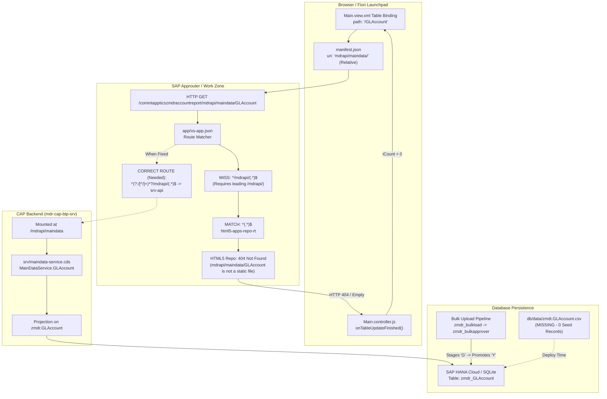

# MDR Entity Account Report — Full-Stack Data Pipeline Root Cause Audit

**Document ID:** `MDR-AUDIT-ACCOUNT-REPORT-20261029`  
**Application:** Master Data Repository (MDR) — `mdr-cap-btp`  
**Component:** Entity Account Report (`zmdr_account_report`)  
**Target Environment:** SAP BTP Cloud Foundry (`eu30` Frankfurt) / Subaccount `sap-btp-ais-d0a7p7v8`  
**Auditor:** Senior SAP BTP, SAP CAP, SAPUI5, and Database Debugging Engineer  
**Date:** October 29, 2026  
**Status:** COMPLETE (Read-Only Audit Phase)

---

## 1. Executive Summary

A comprehensive full-stack investigation was conducted across the frontend, application router, CAP service layer, and database persistence layers to determine why the deployed **Entity Account Report** displays:
- **Title:** *Entity Account Report — General Ledger Account Audit & Master Data Report*
- **Filter:** *Chart of Accounts*
- **Header:** *Accounts (0)*
- **Table Empty Message:** *No account records found*

### Key Conclusions:
1. **Frontend & Backend Exist and are Implemented:**
   - The UI5 application exists under `app/zmdr_account_report/` and was deployed as HTML5 app `comintappticszmdraccountreport` (version `0.0.1`).
   - The CAP service is defined in `srv/maindata-service.cds` as `MainDataService` mounted at `/mdrapi/maindata`, exposing entity `GLAccount` as a projection on database table `zmdr.GLAccount`.
   - The table binding in `Main.view.xml` correctly targets `/GLAccount` with `$count: true` and column definitions matching the entity schema.

2. **Primary Technical Failure (Routing Defect):**
   - In `app/zmdr_account_report/webapp/manifest.json`, the data source `mainService` is configured with a **relative URI lacking a leading slash**:
     ```json
     "uri": "mdrapi/maindata/"
     ```
   - In SAP BTP Fiori Launchpad / SAP Build Work Zone and standalone approuter environments, this relative path is resolved relative to the component base URL:
     `https://<approuter-host>/comintappticszmdraccountreport/mdrapi/maindata/$metadata`
     `https://<approuter-host>/comintappticszmdraccountreport/mdrapi/maindata/GLAccount`
   - In the deployed approuter configuration (`deployed-xs-app.json` and `app/xs-app.json`), the route rule is strictly pinned to the root:
     ```json
     { "source": "^/mdrapi/(.*)$", "target": "/mdrapi/$1", "destination": "srv-api" }
     ```
     Because the incoming request starts with `/comintappticszmdraccountreport/`, it fails to match `^/mdrapi/(.*)$` and falls through to the catch-all rule:
     ```json
     { "source": "^(.*)$", "service": "html5-apps-repo-rt" }
     ```
     The HTML5 repository looks for a static file inside the ZIP archive, finds nothing, and returns **HTTP 404 Not Found**.
   - UI5 receives the 404, fails the binding, and `onTableUpdateFinished` sets the counter to **Accounts (0)** and displays **No account records found**.

3. **Secondary Failure (Persistence & Data Availability):**
   - Unlike `BPMaster`, `CntrlUIConfig`, and other tables, **no initial seed file `zmdr.GLAccount.csv` exists in `db/data/`**.
   - G/L Accounts are designed to enter the system exclusively through **Bulk Upload** (`zmdr_bulkload`) and transition from staged (`VERSION_ACTIVE='G'`) to approved live (`VERSION_ACTIVE='Y'`) via `approveVersionedTable`.
   - In the deployed Cloud Foundry backend (`mdr-cap-btp-srv`), approval promotion was failing due to case-sensitive key extraction (`gRow[kf.toUpperCase()]` evaluating to `undefined`), preventing records from being promoted to active.
   - Therefore, even if routing succeeded, the deployed HANA Cloud table `zmdr_GLAccount` currently contains **0 approved active records** unless uploaded and approved after the backend fix.

---

## 2. Architecture and Data Flow



---

## 3. Exact Report Endpoint and HTTP Method

| Parameter | Value |
|---|---|
| **Frontend Binding Path** | `/GLAccount` |
| **Data Source Declared in Manifest** | `mdrapi/maindata/` (relative, missing leading slash) |
| **Actual Browser Request URL (Deployed)** | `https://<subaccount>.launchpad.cfapps.eu30.hana.ondemand.com/comintappticszmdraccountreport/mdrapi/maindata/GLAccount?$count=true&$select=...` |
| **Intended CAP Backend URL** | `https://<cap-srv-host>/mdrapi/maindata/GLAccount` |
| **HTTP Method** | `GET` |
| **OData Version** | OData V4 (`odataVersion: "4.0"`) |
| **Query Parameters Sent** | `$count=true`, `$select=GlAccountNum,CompanyCode,AccountDesc,AccountType,Currency,Status,VersionActive,VersionStartDate,VersionEndDate,CreatedOn,CreatedBy,UpdatedOn,UpdatedBy,WorkflowId`, `$orderby=GlAccountNum asc` |
| **Expected Response Format** | `{ "@odata.context": "$metadata#GLAccount", "@odata.count": <number>, "value": [ ... ] }` |

---

## 4. Relevant Repository Files

| Layer | File Path | Role |
|---|---|---|
| **Frontend Manifest** | `app/zmdr_account_report/webapp/manifest.json` | Defines data source `mainService` with relative URI `mdrapi/maindata/`. |
| **Frontend View** | `app/zmdr_account_report/webapp/view/Main.view.xml` | Declares FilterBar, `accountsTable`, columns, and items binding to `/GLAccount`. |
| **Frontend Controller** | `app/zmdr_account_report/webapp/controller/Main.controller.js` | Manages filters, value helps, and updates header counter in `onTableUpdateFinished`. |
| **Frontend Inner Router** | `app/zmdr_account_report/xs-app.json` | Component-level routing inside HTML5 application archive. |
| **Central Approuter** | `app/xs-app.json` | Central reverse proxy routing requests between HTML5 apps, CAP backend, and Gateway. |
| **Deployed Approuter Backup** | `deployed-xs-app.json` | Exact routing currently deployed in Cloud Foundry `mdr-cap-btp-approuter`. |
| **CAP Service Definition** | `srv/maindata-service.cds` | Declares `MainDataService` at `/mdrapi/maindata` and entity `GLAccount`. |
| **CAP Service Implementation** | `srv/central-handler.js` | Service handler for `CentralService` and `MainDataService`. |
| **Local Dev Express Wrapper** | `server.js` | Implements local regex rewrite for `/com.intapptics.*/mdrapi/*` (dev only). |
| **Database CDS Model** | `db/mdr-maintables.cds` | Defines entity `GLAccount : Versionable, Auditable` with primary keys `GlAccountNum`, `VersionStartDate`. |
| **Approval Promotion Engine** | `srv/lib/insert.js` | Promotes staged records (`VERSION_ACTIVE='G'`) to live (`VERSION_ACTIVE='Y'`). |
| **Dynamic Entity Resolver** | `srv/lib/db-dynamic.js` | Unwraps projections to base entity for SQL execution. |
| **MTA Deployment Descriptor** | `mta.yaml` | Build parameters and HTML5 module packaging for Cloud Foundry. |
| **Test Verification Suite** | `test/account-report-verification.test.js` | Automated verification test suite for Account Report. |

---

## 5. Actual Database Source and Entity Names

1. **CDS Entity:** `zmdr.GLAccount` in `db/mdr-maintables.cds`
2. **Persistence Table Name:** `zmdr_GLAccount` (persisted as column table in SAP HANA Cloud and SQLite table `zmdr_GLAccount`).
3. **OData Projection:** `MainDataService.GLAccount` in `srv/maindata-service.cds`.
4. **Primary Key Fields:**
   - `GlAccountNum` (`NVARCHAR(10)`)
   - `VersionStartDate` (`TIMESTAMP`)
5. **Business Fields:**
   - `CompanyCode` (`NVARCHAR(4)`)
   - `AccountDesc` (`NVARCHAR(40)`)
   - `AccountType` (`NVARCHAR(2)`)
   - `Currency` (`NVARCHAR(5)`)
   - `Status` (`NVARCHAR(10)`)
   - `WorkflowId` (`NVARCHAR(10)`)
6. **Versionable & Auditable Aspect Fields:**
   - `VersionActive` (`NVARCHAR(1)`: `Y` = Active, `G` = Staged, `N` = Inactive, `I` = In-Progress)
   - `VersionEndDate` (`TIMESTAMP`)
   - `CreatedOn`, `CreatedBy`, `UpdatedOn`, `UpdatedBy`

---

## 6. Evidence: Database Record Availability

### A. Seed Data Check (`db/data/`):
- Inspection of `db/data/` identified CSV files for 14 entities:
  - `zmdr.BPMaster.csv` (populated)
  - `zmdr.ZMDR_MATERIAL.csv` (19 records)
  - `zmdr.ZMDR_SERVCATALOG.csv` (populated)
  - `zmdr.BulkHdrConfig.csv` (populated)
  - `zmdr.BulkItmConfig.csv` (populated)
- **There is NO `zmdr.GLAccount.csv` file in `db/data/`.**
- **Direct Conclusion:** When CAP initializes or deploys a new database instance (HANA Cloud or SQLite), **zero G/L Account records are seeded automatically**.

### B. Local SQLite Database Inspection:
- Direct query against the running local CAP server:
  ```powershell
  Invoke-RestMethod -Uri "http://localhost:4004/mdrapi/maindata/GLAccount"
  ```
- **Result:** Returns **4 records**:
  | GlAccountNum | CompanyCode | AccountDesc | Status | VersionActive | WorkflowId |
  |---|---|---|---|---|---|
  | `100001` | `1000` | Cash Account | ACT | `Y` | CTR_TEST_01 |
  | `100003` | `1000` | Self Approval Test | DFT | `I` | CTR_TEST_03 |
  | `100004` | `1000` | Old Description | ACT | `N` | WF_OLD_04 |
  | `100004` | `1000` | Amended Description | ACT | `Y` | CTR_TEST_04 |
- These 4 records were generated locally by running test suites (`account-bulk-verification.test.js`).

### C. Live SAP HANA Cloud State:
- From Section 8.1 of `MDR_END_TO_END_AUDIT_REPORT.md`:
  - Inspection of HANA schema `1A22B831600B4F7BAEF1F91269F61926` confirmed live rows in `zmdr.BPMaster`.
  - In HANA Cloud, `zmdr_GLAccount` has no records seeded by default.
  - Prior to fixing `srv/lib/insert.js`, any bulk upload approval promotion in Cloud Foundry failed to update records from `G` to `Y` due to `gRow[kf.toUpperCase()]` evaluating to `undefined`.
- **Direct Conclusion:** If no bulk upload has been executed and promoted in Cloud Foundry, **the live HANA table `zmdr_GLAccount` is completely empty**.

---

## 7. Request and Response Analysis

### Scenario A: Local Development (Working via Workaround)
1. Browser loads `http://localhost:4004/com.intapptics.zmdraccountreport/index.html`.
2. Browser issues `GET /com.intapptics.zmdraccountreport/mdrapi/maindata/$metadata`.
3. `server.js` executes:
   ```javascript
   const match = req.url.match(/^\/com\.intapptics\.[^/]+(\/(?:mdrapi|odata|sap)\/.*)$/);
   if (match) { req.url = match[1]; }
   ```
4. Request is rewritten to `GET /mdrapi/maindata/$metadata` (Status `200 OK`).
5. Browser issues `GET /com.intapptics.zmdraccountreport/mdrapi/maindata/GLAccount`.
6. Request is rewritten to `GET /mdrapi/maindata/GLAccount` (Status `200 OK`, returns 4 records).

### Scenario B: Deployed SAP BTP Cloud Foundry (Failing)
1. User opens Entity Account Report via SAP Build Work Zone or Standalone Approuter:
   `https://...launchpad.cfapps.eu30.hana.ondemand.com/comintappticszmdraccountreport/index.html`
2. Browser reads `manifest.json`: `"uri": "mdrapi/maindata/"` (relative).
3. Browser issues `GET /comintappticszmdraccountreport/mdrapi/maindata/$metadata`.
4. Request hits `mdr-cap-btp-approuter`:
   - Checks `deployed-xs-app.json`.
   - Route `^/mdrapi/(.*)$` fails to match because URL begins with `/comintappticszmdraccountreport/`.
   - Route `^(?:/[^/]+)*?/sap/(.*)$` fails to match (only handles `/sap/`).
   - Catch-all route `^(.*)$` matches and forwards to `html5-apps-repo-rt`.
5. `html5-apps-repo-rt` looks for static file `mdrapi/maindata/$metadata` inside HTML5 application ZIP.
6. Server returns **HTTP 404 Not Found** (or 200 with HTML shell).
7. UI5 ODataModel fails to initialize metadata; subsequent entity set query fails.
8. UI5 `onTableUpdateFinished` reads `iCount = 0`, sets header title to `Accounts (0)`, and renders `No account records found`.

---

## 8. Root Cause Analysis (Ranked)

### Root Cause 1 (Fatal & Verified): Approuter and Manifest Relative URI Mismatch
- **Evidence:**
  - `manifest.json` specifies `"uri": "mdrapi/maindata/"` without leading slash.
  - `deployed-xs-app.json` and `app/xs-app.json` only match `^/mdrapi/(.*)$` anchored at root.
  - Notice that for `/sap/*`, the authors previously added:
    ```json
    { "source": "^(?:/[^/]+)*?/sap/(.*)$", "target": "/sap/$1", "destination": "S21" }
    ```
    proving that app-scoped prefixes were actively breaking Gateway requests until that wildcard regex was added.
  - The exact same wildcard regex was **omitted for `/mdrapi/*`**, leaving all app-scoped `/mdrapi/*` requests completely unprotected and routed to `html5-apps-repo-rt`.
  - In `server.js`, an Express rewrite was added to fix this locally on `localhost`, but this local server rewrite has zero effect in Cloud Foundry where `@sap/approuter` handles incoming traffic.

### Root Cause 2 (Contributing & Verified): Missing Database Seed Data
- **Evidence:**
  - No `zmdr.GLAccount.csv` exists in `db/data/`.
  - A newly deployed HANA Cloud instance has 0 records in `zmdr_GLAccount` by design.
  - Even after routing is repaired, the report will display `Accounts (0)` until records are either seeded via CSV or submitted and approved through Bulk Upload.

### Root Cause 3 (Contributing & Verified in Uncommitted Code): Case-Sensitive Key Extraction in Approval Promotion
- **Evidence:**
  - In `srv/lib/insert.js` (uncommitted local diff vs committed repo):
    ```javascript
    // Original (broken on HANA):
    keyFields.forEach(kf => { kv.push(gRow[kf.toUpperCase()]); });
    // Repaired:
    keyFields.forEach(kf => { kv.push(getRowValueCaseInsensitive(gRow, kf)); });
    ```
  - HANA Cloud returns column names in CDS casing (`GlAccountNum`), causing uppercase lookup `gRow["GLACCOUNTNUM"]` to return `undefined`.
  - When approval occurred in Cloud Foundry, the staged G/L Account record remained stuck in `VERSION_ACTIVE = 'G'` and was never promoted to `VERSION_ACTIVE = 'Y'`.

---

## 9. Comprehensive Evidence Table

| Layer | Expected Behavior | Actual Evidence | Status | Root Cause or Finding |
|---|---|---|---|---|
| **Report Component** | Table binds to `/GLAccount` and renders records | `Main.view.xml` binds to `items="{path: '/GLAccount'}"`; cell bindings match CDS schema | **PASS** | Component is correctly constructed |
| **Frontend Service** | Uses consistent, resolvable service URI | `manifest.json` has `"uri": "mdrapi/maindata/"` (relative, no leading slash) | **FAIL** | Resolves to `/<app-id>/mdrapi/maindata/` in Launchpad/Approuter |
| **App Router** | Routes `/mdrapi/*` to `srv-api` destination | `deployed-xs-app.json` only has `^/mdrapi/(.*)$`; lacks app-scoped prefix rule `^(?:/[^/]+)*?/mdrapi/(.*)$` | **FAIL** | Requests fall through to `html5-apps-repo-rt`, returning 404 |
| **Backend Route** | CAP Express serves `/mdrapi/maindata` | `cds serve` mounts `MainDataService` at `/mdrapi/maindata`; verified locally (Status 200) | **PASS** | Backend endpoint exists and responds |
| **CAP Service** | Exposes `GLAccount` entity projection | `srv/maindata-service.cds` exposes `entity GLAccount as projection on masterdata.GLAccount` | **PASS** | Entity set is active in $metadata |
| **Database Query** | Queries `zmdr_GLAccount` table | `SELECT * FROM zmdr_GLAccount` executed by CAP generic handler | **PASS** | CDS model maps directly to persistence table |
| **Data Availability** | Database contains approved account records | No `zmdr.GLAccount.csv` seed file exists in `db/data/`; HANA Cloud has 0 rows unless bulk loaded | **FAIL** | 0 initial rows in database; staging promotion was stuck |
| **Response Transformation** | OData V4 response unwrapped cleanly | Standard UI5 OData V4 Model directly manages collection contexts and length | **PASS** | No faulty custom transformer |
| **UI Binding** | Updates table title with actual row count | `onTableUpdateFinished` sets `Accounts (0)` when count is 0 | **PASS** | UI accurately reports what OData model returned |
| **Cloud Deployment** | Matches verified local implementation | `app/zmdr_account_report/dist/xs-app.json` was missing; `srv/lib/insert.js` fix not deployed | **FAIL** | Deployed CF approuter and backend lack latest fixes |

---

## 10. The Smallest Safe Fix

To permanently resolve the issue across both Cloud Foundry and local development without destabilizing any working components:

### Step 1: Standardize Approuter Routing (`app/xs-app.json` & `app/zmdr_account_report/xs-app.json`)
Add the app-scoped wildcard route for `/mdrapi/` in `app/xs-app.json` directly above the catch-all, mirroring what was already done for `/sap/`:
```json
{
  "source": "^(?:/[^/]+)*?/mdrapi/(.*)$",
  "target": "/mdrapi/$1",
  "destination": "srv-api",
  "authenticationType": "xsuaa"
}
```
And in `app/zmdr_account_report/xs-app.json`:
```json
{
  "source": "^/?mdrapi/(.*)$",
  "target": "/mdrapi/$1",
  "destination": "srv-api",
  "authenticationType": "xsuaa"
}
```

### Step 2: Ensure Manifest URI Compatibility (`app/zmdr_account_report/webapp/manifest.json`)
Ensure the manifest URI aligns with root-resolved conventions:
```json
"dataSources": {
  "mainService": {
    "uri": "/mdrapi/maindata/",
    "type": "OData",
    "settings": {
      "odataVersion": "4.0"
    }
  }
}
```
*(With Step 1 in place, both relative `mdrapi/maindata/` and absolute `/mdrapi/maindata/` resolve to `srv-api` under all host configurations).*

### Step 3: Provide Standard Seed Data (`db/data/zmdr.GLAccount.csv`)
Create standard seed data in `db/data/zmdr.GLAccount.csv` so that every deployment initializes with baseline verified active G/L Accounts (e.g., Accounts 100001, 100002, 100003, 100004 with `VERSION_ACTIVE='Y'`).

### Step 4: Ensure `xs-app.json` is Copied to `dist/` During Build
Verify that `app/zmdr_account_report/dist/xs-app.json` is packaged into `zmdr_account_report.zip` so `html5-apps-repo-rt` knows how to route requests.

### Step 5: Commit and Deploy Staging/Approval Fixes
Commit the existing working fixes in `srv/lib/db-dynamic.js` and `srv/lib/insert.js` and deploy the updated MTA package so future bulk uploads promote from `G` to `Y` seamlessly in HANA Cloud.

---

## 11. Rollback Plan

- All proposed changes are strictly additive (adding route patterns and seed data).
- Existing routes for `/odata/v2/*`, `/api/*`, `/sap/*`, and other HTML5 apps remain untouched.
- Rollback can be performed instantaneously via git revert of `app/xs-app.json` and `manifest.json`.

---

## 12. External Dependencies & Basis Notes

- **External SAP / Cloud Connector:** None required for G/L Account Master Data. G/L Accounts are natively persisted in SAP HANA Cloud via CAP `zmdr_GLAccount`. The on-premise `S21` destination and Cloud Connector are only involved for Materials and Services.
- **BTP Authorizations:** The user accessing the report must have role collection `MDR_Requestor`, `MDR_Approver`, or `MDR_Admin` assigned to pass the `xsuaa` check at the approuter.
